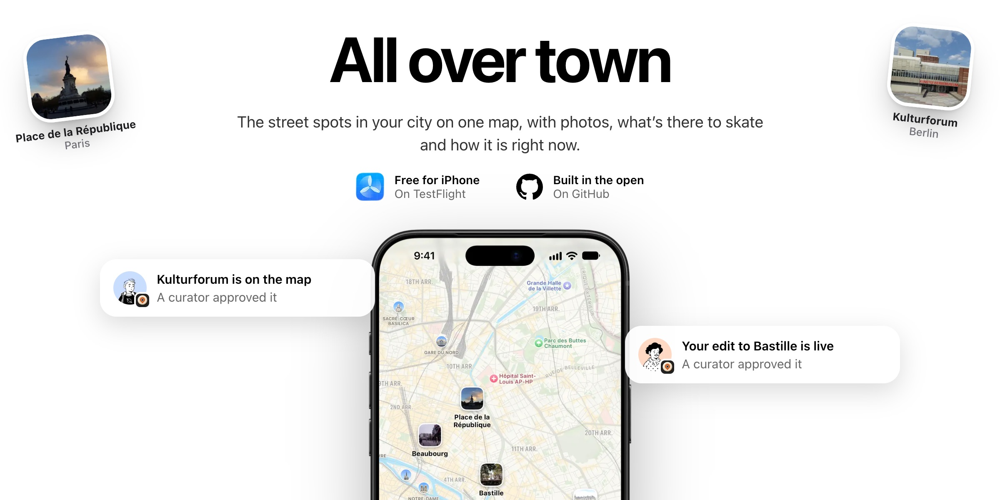

  

<h1 align="center">OpenSkateMap API</h1>

  The API and website behind <a href="https://openskatemap.app">OpenSkateMap</a>, an open, hand-curated map of skate spots.

  
  
  
  

  <a href="RUNNING.md">Running it locally</a> ·
  <a href="CONTRIBUTING.md">Contributing</a> ·
  <a href="https://github.com/OpenSkateMap/ios">iOS app</a>

## About

One Cloudflare Worker serves the API the [iOS app](https://github.com/OpenSkateMap/ios) talks to:
sign-in, syncing the map, adding and reviewing spots, collections, profiles, photos and notifications. A second
Worker serves [openskatemap.app](https://openskatemap.app): the landing page, the legal texts and the pages a shared
spot link opens, with a card made for that spot.

| | |
|---|---|
| `apps/api` | The API: [Hono](https://hono.dev) with [Zod](https://zod.dev) schemas on every route, Better Auth for Sign in with Apple |
| `apps/web` | openskatemap.app: static pages from Markdown, and spot pages with share cards drawn by Cloudflare Images |
| `packages/db` | The [Drizzle](https://orm.drizzle.team) schema, SQL migrations and the migration runner |

Data lives in Postgres with PostGIS (PlanetScale, through Hyperdrive) and photos in R2.

## Contributing

Bug reports, fixes, tests and docs are welcome. For a new endpoint or a change to the rules (who can see or change
what), open an issue first. [RUNNING.md](RUNNING.md) runs it locally or on your own Cloudflare account, and
[CONTRIBUTING.md](CONTRIBUTING.md) covers how it works and how changes land. To report a security issue, see
[SECURITY.md](SECURITY.md); please don't open a public issue.

## License

The code is free software under the GNU Affero General Public License, version 3 or later: see [LICENSE](LICENSE).
If you run a modified copy for others to use, its source must be available to them too.

## Assets

The AGPL doesn't cover the OpenSkateMap name and icon, the website's images, the README header or the fonts.
[NOTICE.md](NOTICE.md) lists each one and its terms.
